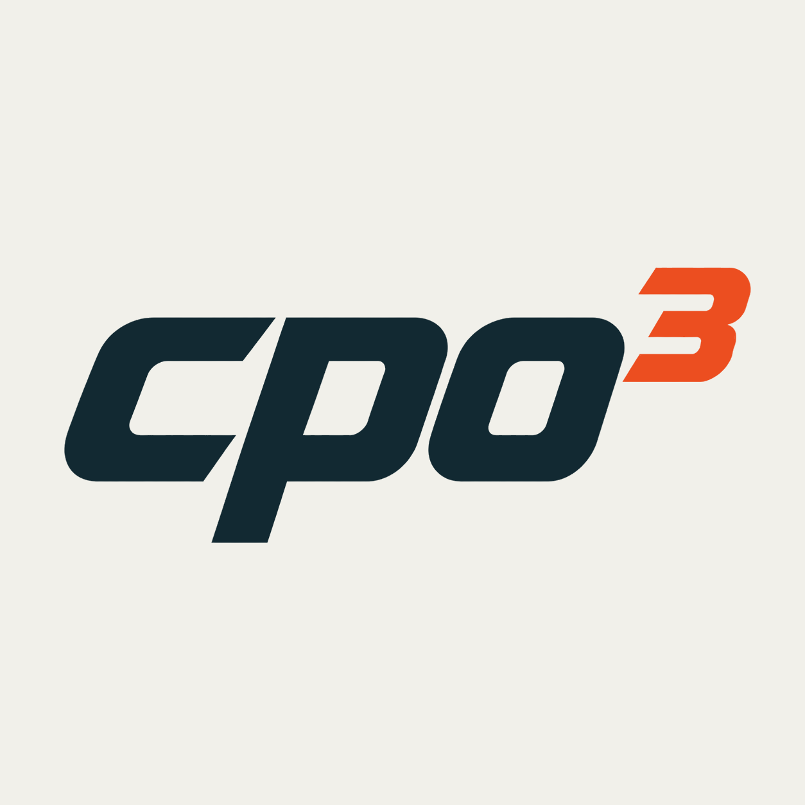

  <picture>
    <source media="(prefers-color-scheme: dark)" srcset="https://raw.githubusercontent.com/cpo3-org/.github/main/assets/logo-dark.png">
    
  </picture>

## Sparse optimization in Rust and Python

**[cpo3](https://github.com/cpo3-org/cpo3)** is an open-source interior-point
solver for convex linear and quadratic programs, written in Rust with a typed
Python interface.

- Sparse linear algebra with Faer and optional Accelerate, CHOLMOD, and PARDISO backends.
- Presolve, warm starts, and certificates of infeasibility.
- Continuous MPS and QPS file support.

[Get started](https://github.com/cpo3-org/cpo3#readme)
· [Source code](https://github.com/cpo3-org/cpo3)
· [Report an issue](https://github.com/cpo3-org/cpo3/issues)

Developed by Matteo Santamaria, Michael Cummins, and Brendan O'Donoghue.
Released under the [MIT license](https://github.com/cpo3-org/cpo3/blob/main/LICENSE).
